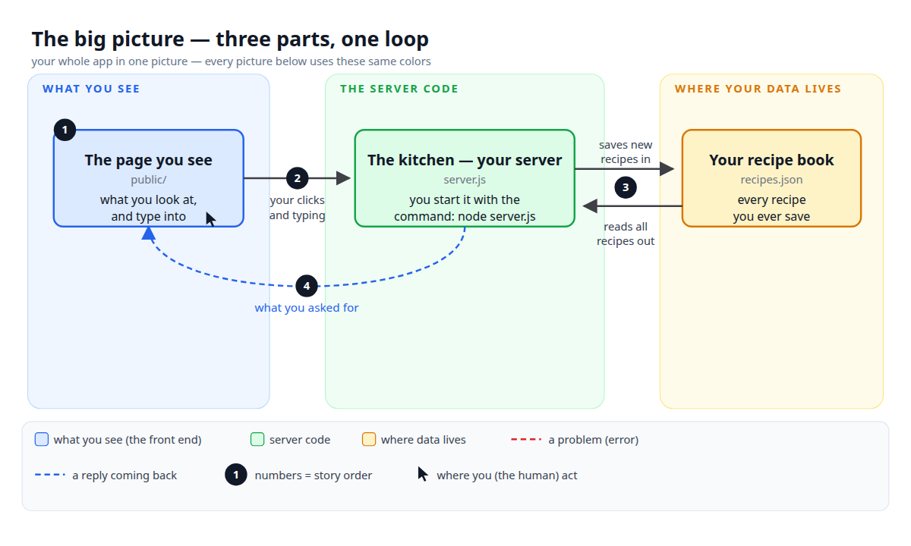

# Explain It With Pictures

An open-source skill for AI coding agents (Claude Code, opencode, Cursor, Codex…) that turns any codebase into **illustrated, annotated explanations a non-technical person can follow**.

Built for **vibe coders** — people who build working software by prompting AI and end up owning something they can't fully explain. Ask your agent *"explain how my project works"* and instead of a wall of jargon you get a single illustrated HTML document: hand-drawn diagrams with numbered story steps, labeled arrows, plain-words captions, an annotated file tree, and a glossary.


*A diagram the skill produced for a small real app. Every box is dual-labeled (plain words + the real filename), every arrow says what travels on it, numbers tell the story in reading order.*

## Free and simple, on purpose

- **Hand-drawn, not AI-generated.** The agent draws SVG diagrams itself. Text stays crisp, edits are one-line changes, files stay tiny — and it never calls an image-generation API.
- **One self-contained file.** No dependencies, no CDNs, no build step. Opens offline in any browser, prints to PDF cleanly.
- **Zero paid services.** No accounts, no network calls, no API keys.
- **Readable by someone who has never coded.** Every technical word is defined at first use and gathered into a glossary; every diagram ends with an "In plain words:" analogy caption.

## What you get

Ask your agent:

> "Explain how my project works — illustrate it. I built this with AI and don't really understand it."

You'll get `docs/how-it-works.html` in your project, containing:

1. A one-paragraph, zero-jargon summary
2. **The big picture** — every part and how they connect
3. **What happens when you…** — a "day in the life" diagram per user action
4. Your data opened up and labeled, field by field
5. **The cast of characters** — every file in one human sentence, including what happens if you delete it
6. **Words you'll hear** — the glossary
7. **How to explain it to a friend** — a three-sentence summary you can repeat

See it for real: [`examples/recipe-saver-explainer.html`](examples/recipe-saver-explainer.html) explains a small working recipe app ([`examples/recipe-saver/`](examples/recipe-saver/)) end to end — open it in a browser. Full-page preview: [`assets/explainer-full.png`](assets/explainer-full.png).

## Install

**Skills CLI:**

```bash
npx skills add imranshiundu/explain-it-with-pictures@explain-it-with-pictures -g -y
```

**Manual:** clone and copy (or symlink) the `explain-it-with-pictures/` folder into your agent's skills directory:

| Agent | Global | Project |
|---|---|---|
| Claude Code | `~/.claude/skills/` | `.claude/skills/` |
| opencode | `~/.config/opencode/skills/` | `.opencode/skills/` |
| Cursor / Codex / others | your agent's skills folder | |

```bash
git clone https://github.com/imranshiundu/explain-it-with-pictures
ln -s "$(pwd)/explain-it-with-pictures/explain-it-with-pictures" ~/.claude/skills/explain-it-with-pictures
```

The skill fires on questions like *"how does my app work?"*, *"make me a diagram"*, *"explain this to a non-programmer"* — no special invocation needed.

## What the skill teaches your agent

- **One question per diagram** — a second question earns a second diagram.
- **Dual-label every box** — "The kitchen — your server" over `server.js`: the reader learns the map and the territory together.
- **Number the story** — ①②③ bubbles on the flow path, with a caption that walks the numbers.
- **Label every arrow** — "your recipe, as a message", "if something is missing: a friendly error".
- **Five colors, one meaning each** — blue = what you see, green = server code, amber = where data lives, red = errors, gray = outside services. Same meanings in every diagram.
- **Mark user touchpoints** — a cursor glyph wherever a human clicks or types.
- **Sustain one analogy** — if the server is a kitchen, it stays a kitchen for the whole document.
- **Simplify honestly** — "(simplified)" markers where steps were collapsed.
- **Scale by zooming, never crowding** — big codebases get subsystem boxes in the big picture and a diagram each.

Three templates ship with it: a fully-worked annotated SVG (the image above came from it), the explainer HTML skeleton, and a Mermaid pattern for chat / pull-request answers.

## Verify / develop

```bash
./scripts/verify.sh
```

Runs the whole loop on any machine with `node` + `python3` + `curl`:

- SVG template geometry check (no colliding or clipped labels)
- Example explainer validation (balanced HTML, zero external references, all diagrams valid)
- Live smoke test of the example app (endpoints, validation errors, path-traversal blocked)
- Fixture-integrity check (tests never dirty the demo data)

## License

[MIT](LICENSE) — use it, fork it, ship it. Annotated diagrams for everyone.
