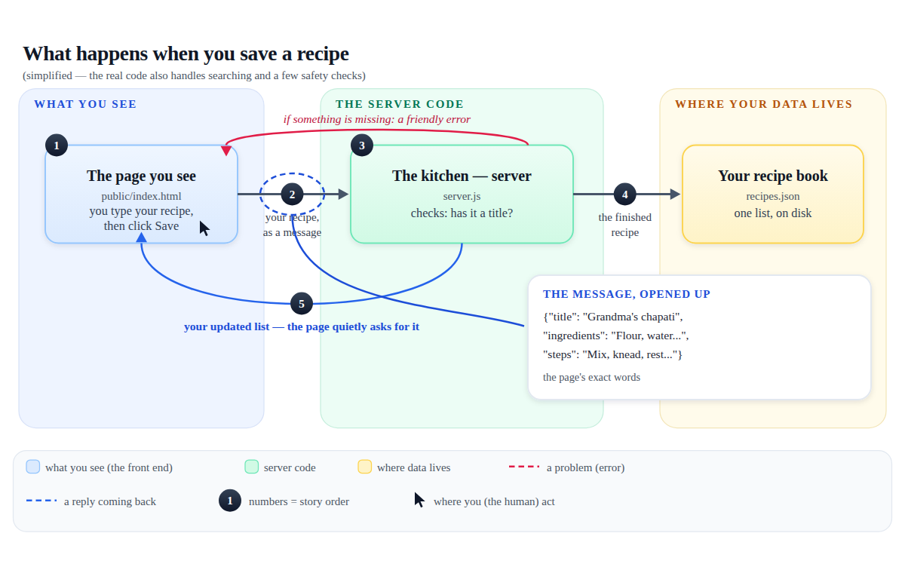

# Explain It With Pictures

An open-source skill for AI coding agents (Claude Code, opencode, Cursor, Codex…) that turns any codebase into **illustrated, annotated explanations a non-technical person can follow** — with a locked design system, a checker-enforced geometry, and a story structure, so agents stop producing the overlapping-box diagrams you've seen everywhere.

Built for **vibe coders** — people who build working software by prompting AI and end up owning something they can't explain. Ask your agent *"explain how my project works"* and instead of a wall of jargon you get a single illustrated HTML document: hand-drawn diagrams that animate their story step by step, labeled arrows, plain-words captions, an annotated file hierarchy, and a glossary.


*A diagram the skill produced for a small real app: labeled zones, dual-labeled boxes (plain words + real filename), numbered story bubbles, labeled arrows, a legend — every gap and label mechanically checked.*

## Free and simple, on purpose

- **Hand-drawn, not AI-generated.** The agent draws SVG diagrams itself. Text stays crisp, edits are one-line changes, files stay tiny — and it never calls an image-generation API.
- **One self-contained file.** No dependencies, no CDNs, no build step. Fonts are embedded as base64 (SIL OFL), so it opens offline with its typography intact and prints to a clean PDF. Try it: [recipe-saver-explainer.pdf](assets/recipe-saver-explainer.pdf) (9 pages, straight from Print).
- **Zero paid services.** No accounts, no network calls, no API keys.
- **Readable by someone who has never coded.** Every technical word defined at first use and gathered into a glossary; every diagram ends with an "In plain words:" analogy caption.

## What's in the design system

The skill ships more than rules — it ships *enforcement*:

| Layer | What it does |
|---|---|
| **Type scale** | Five sizes, far apart: Fraunces (display) for titles, Inter for body, JetBrains Mono for real names — embedded, subset, offline |
| **Geometry safety** | Box width = text + 2×14px padding; 8px text-to-edge clearance; 24px box-to-box gaps; labels in gutters; arrows at box edges. Enforced by `scripts/check-svg.py` — overlapping text is a build failure, not a hope |
| **Diagram library** | Seven types, chosen by the question they answer: flow, hierarchy, comparison, timeline, anatomy, decision tree, small multiples + zoom-in callouts — all in [templates/diagram-kit.svg](explain-it-with-pictures/templates/diagram-kit.svg) |
| **Story structure** | Hook → reveal → mechanism → payoff → takeaway: plain-words hook, the big picture, day-in-the-life flows, data anatomy, the book over time, the cast of files, glossary, elevator |
| **Motion** | One reveal per diagram, on scroll, in story order: zones settle → boxes fade → arrows draw → bubbles pop → insets last. All under 1.2s, spring-eased |
| **Accessibility** | Reduced-motion gets the static page; JS dies → content stays visible; every diagram titled; print forces final states |
| **Color** | Ground / ink / muted / accent roles + five semantic diagram colors — every text pair WCAG-checked (44 pairs in CI) |

## What you get

Ask your agent:

> "Explain how my project works — illustrate it. I built this with AI and don't really understand it."

You'll get `docs/how-it-works.html` in your project, containing the full story: the big picture, an animated day-in-the-life for every user action (with a zoom-in on the actual messages that travel), your data opened up field by field, your data's states over time, the cast of files as a hierarchy, the glossary, and a three-sentence summary to repeat to a friend.

The skill was run end-to-end against a small real app — see every diagram type in one place in [assets/diagram-kit.png](assets/diagram-kit.png), then:

- **The app:** [`examples/recipe-saver/`](examples/recipe-saver/) — a real recipe saver with a server, a page, and a data file
- **The result:** [`examples/recipe-saver-explainer.html`](examples/recipe-saver-explainer.html) — open it in a browser and scroll
- **More diagrams:** [save flow with message inset](assets/example-save-flow.png) · [small multiples](assets/example-small-multiples.png) · [file hierarchy](assets/example-hierarchy.png) · [full page](assets/explainer-full.png) · [print](assets/recipe-saver-explainer.pdf)


*The save flow — including a zoom-in inset showing the actual JSON message that travels from page to server.*

## Install

**Skills CLI:**

```bash
npx skills add imranshiundu/explain-it-with-pictures@explain-it-with-pictures -g -y
```

**Manual:** clone and copy (or symlink) the `explain-it-with-pictures/` folder into your agent's skills directory:

| Agent | Global | Project |
|---|---|---|
| Claude Code | `~/.claude/skills/` | `.claude/skills/` |
| opencode | `~/.config/opencode/skills/` | `.opencode/skills/` |
| Cursor / Codex / others | your agent's skills folder | |

```bash
git clone https://github.com/imranshiundu/explain-it-with-pictures
ln -s "$(pwd)/explain-it-with-pictures/explain-it-with-pictures" ~/.claude/skills/explain-it-with-pictures
```

The skill fires on questions like *"how does my app work?"*, *"make me a diagram"*, *"explain this to a non-programmer"* — no special invocation needed.

## What the skill teaches your agent

- **One question per diagram**, answered by the right **type** — flow for actions, hierarchy for structure, anatomy for internals, small multiples for states, comparison for change, timeline for time, decision tree for branching.
- **Geometry safety, mechanically enforced** — boxes sized to their text, 24px gaps, labels in gutters, no text ever touching text.
- **Dual-label every box** — "The kitchen — server" over `server.js`.
- **Number the story** — bubbles on the flow path, caption walks the numbers.
- **Five semantic colors**, legends on every flow, same meanings everywhere.
- **Zoom-in callouts** — "here's what the message actually looks like".
- **One sustained analogy** — if the server is a kitchen, it stays a kitchen.
- **Honest simplification** — "(simplified)" markers where steps were collapsed.
- **Move with restraint** — story-ordered reveals, reduced-motion-safe, print-safe.

## Stress test it

```bash
./scripts/verify.sh
```

Runs the whole loop on any machine with `node` + `python3` + `curl` (render/PDF checks need Chrome, skipped-and-declared otherwise):

- **Geometry gate** — text-in-box padding, 24px box gaps, label placement, glyph coverage — on the kit and every example diagram
- **Explainer validation** — balanced HTML, zero loaded external resources, valid diagrams, embedded fonts decode, motion/print/JS-gating present, every diagram titled
- **WCAG 2.1 contrast audit** — 44 design-system color pairs
- **Live smoke test** — endpoints, validation errors, path-traversal blocked
- **Live render test** — headless Chrome confirms the reveal script runs, and the page prints to a real 9-page PDF

## License

[MIT](LICENSE) — use it, fork it, ship it. Diagrams for everyone.
