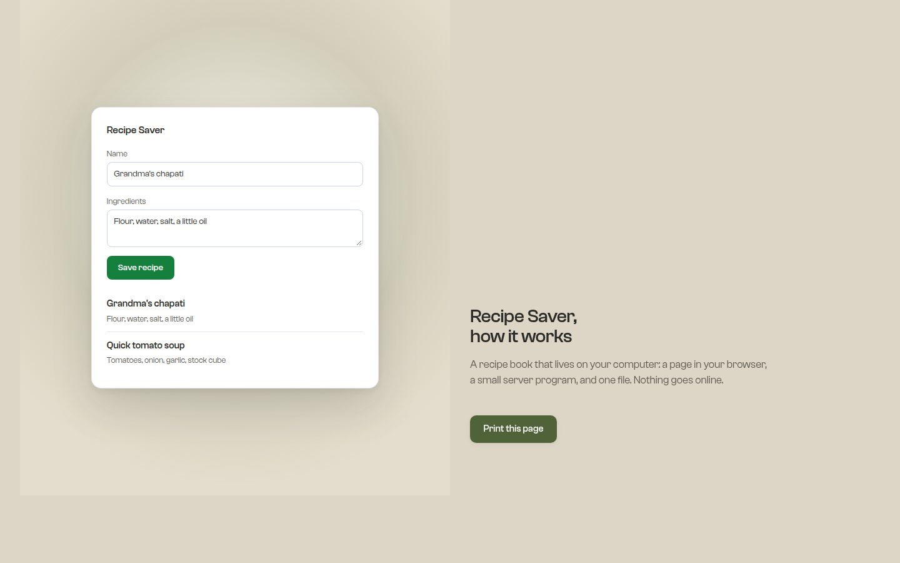

# Explain It With Pictures

An open-source skill for AI coding agents (Claude Code, opencode, Cursor, Codex…) that turns any codebase into **illustrated, annotated explanations a non-technical person can follow** — with a locked design system, a checker-enforced geometry, and a story structure, so agents stop producing the overlapping-box diagrams you've seen everywhere.

Built for **vibe coders** — people who build working software by prompting AI and end up owning something they can't explain. Ask your agent *"explain how my project works"* and instead of a wall of jargon you get a single illustrated HTML document: hand-drawn diagrams that animate their story step by step, labeled arrows, plain-words captions, an annotated file hierarchy, and a glossary.


*The real rendered fold: split hero with a live fragment of the product on the right, the masked headline bottom-left, Clash Grotesk on a sand ground.*

## Design language

The skill was rebuilt through a measured design process (dealt direction → build → lint → real-browser inspection at 1440/768/390px), not by eye:

| Layer | What it does |
|---|---|
| **Direction** | The quiet instrument: radical understatement — the headline is barely larger than the body, diagrams run full width, and the restraint is the claim |
| **Typography** | Clash Grotesk, one family, two weights, embedded as subset base64 (the file stays one offline file) |
| **Hero** | Split in two halves by tone: a real fragment of the product built in HTML (`data-ui`, real labels) on the right — the page's focal point — and the words anchored bottom-left |
| **Motion** | One signature (the masked headline, line by line), then quiet section entrances — a measured floor of 8+ moving elements (the example renders 29) |
| **Pictures** | For software, the product's own interface fragments count as pictures; two photographs of the subject's world carry the analogy, credited on the page |
| **Premium chrome** | Layered white sheets with soft shadows and warm hairline borders, a moss-to-gold reading-progress bar, gradient caption dashes, a 28px-radius closing card — depth on top of the quiet system, every use marked and every gate still green |
| **Accessibility** | Body text in the full ink (9.3:1), story captions at body size, reduced-motion gets the static page, JS dies → everything visible, print forces final states |

## Gates (all must be green)

```bash
./scripts/verify.sh        # geometry, contrast, offline, app smoke, live render, PDF
```

- **Geometry gate** — text-in-box padding, 24px box gaps, label placement, glyph coverage — on every template and diagram
- **Contract audit** — 45 WCAG pairs for the palette (including the gradient endpoints)
- **Lint** — zero banned patterns: no gradients, no shadows at rest, no thin rules, no monospace labels, no eyebrows, no index numbers
- **Real-browser inspection** (with the design-taste-frontend skill installed) — headline line counts, type sizes actually rendered, screen fill, motion count, covered text: **0 FAIL** at desktop, tablet and phone
- **Print test** — the example renders to a real 10-page PDF, single file, fully offline (246KB with fonts and photographs embedded)

## What you get

Ask your agent:

> "Explain how my project works — illustrate it. I built this with AI and don't really understand it."

You'll get `docs/how-it-works.html` in your project, containing the full story: the big picture, an animated day-in-the-life for every user action (with a zoom-in on the actual messages that travel), your data opened up field by field, your data's states over time, the cast of files as a hierarchy, the glossary, and a three-sentence summary to repeat to a friend.

The skill was run end-to-end against a small real app — see every diagram type in one place in [assets/diagram-kit.png](assets/diagram-kit.png), then:

- **The app:** [`examples/recipe-saver/`](examples/recipe-saver/) — a real recipe saver with a server, a page, and a data file
- **The result:** [`examples/recipe-saver-explainer.html`](examples/recipe-saver-explainer.html) — open it in a browser and scroll
- **More renders:** [the scrolled pages](assets/explainer-pages.jpg) · [the diagram kit](assets/diagram-kit.png) · [print, 10 pages](assets/recipe-saver-explainer.pdf)

## Free and simple, on purpose

- **Hand-drawn, not AI-generated.** The agent draws SVG diagrams itself — and the measured gates keep them legible.
- **One self-contained file.** No dependencies, no CDNs, no build step. Fonts and photographs are embedded as base64, so it opens offline with its typography intact and prints to a clean PDF.
- **Zero paid services.** No accounts, no network calls, no API keys.
- **Readable by someone who has never coded.** Every technical word defined at first use and gathered into a glossary; every diagram ends with an "In plain words:" analogy caption.

## Install

**Skills CLI:**

```bash
npx skills add imranshiundu/explain-it-with-pictures@explain-it-with-pictures -g -y
```

**Manual:** clone and copy (or symlink) the `explain-it-with-pictures/` folder into your agent's skills directory:

| Agent | Global | Project |
|---|---|---|
| Claude Code | `~/.claude/skills/` | `.claude/skills/` |
| opencode | `~/.config/opencode/skills/` | `.opencode/skills/` |
| Cursor / Codex / others | your agent's skills folder | |

```bash
git clone https://github.com/imranshiundu/explain-it-with-pictures
ln -s "$(pwd)/explain-it-with-pictures/explain-it-with-pictures" ~/.claude/skills/explain-it-with-pictures
```

The skill fires on questions like *"how does my app work?"*, *"make me a diagram"*, *"explain this to a non-programmer"* — no special invocation needed.

## What the skill teaches your agent

- **One question per diagram**, answered by the right **type** — flow for actions, hierarchy for structure, anatomy for internals, small multiples for states, comparison for change, timeline for time, decision tree for branching.
- **Geometry safety, mechanically enforced** — boxes sized to their text, 24px gaps, labels in gutters, no text ever touching text.
- **Dual-label every box** — "The kitchen — server" over `server.js`.
- **Number the story** — bubbles on the flow path, caption walks the numbers.
- **Five semantic colors**, legends on every flow, same meanings everywhere.
- **Zoom-in callouts** — "here's what the message actually looks like".
- **One sustained analogy** — if the server is a kitchen, it stays a kitchen.
- **Honest simplification** — "(simplified)" markers where steps were collapsed.
- **Move with restraint** — story-ordered reveals, reduced-motion-safe, print-safe.

## Stress test it

```bash
./scripts/verify.sh
```

Runs the whole loop on any machine with `node` + `python3` + `curl` (render/PDF checks need Chrome, skipped-and-declared otherwise):

- **Geometry gate** — text-in-box padding, 24px box gaps, label placement, glyph coverage — on the kit and every example diagram
- **Explainer validation** — balanced HTML, zero loaded external resources, valid diagrams, embedded fonts decode, motion/print/JS-gating present, every diagram titled
- **WCAG 2.1 contrast audit** — 44 design-system color pairs
- **Live smoke test** — endpoints, validation errors, path-traversal blocked
- **Live render test** — headless Chrome confirms the reveal script runs, and the page prints to a real 9-page PDF

## License

[MIT](LICENSE) — use it, fork it, ship it. Diagrams for everyone.
